

  <h1>Jazan Uni SUC Manager (JUSM)</h1>
  
  
<b>A smart, ultra-fast, and highly interactive web application designed to help Jazan University students build, manage, and share their academic schedules with zero conflicts and maximum days off.</b>

  <!-- Badges -->
  

    
    
    
    
    
  

  <i>Developed by: Abdulaziz Mashnawi</i>

---

## About the Project
**JUSM** is an independent, student-developed utility designed specifically for Jazan University students across all colleges and majors. The tool aims to simplify the process of extracting academic schedules from the official university portal, algorithmically analyzing them to build conflict-free schedules tailored to students' needs.

---

## Key Features
* **Smart Automated Scheduling:** Automatically calculates and generates all possible schedule combinations for your selected courses, instantly eliminating any time conflicts.
* **Privacy & Security (100% Offline):** All calculations and file parsing happen strictly client-side within your browser. Your academic data is never uploaded to any server, ensuring complete privacy.
* **Optimized Days Off:** A smart sorting algorithm prioritizes schedules that grant you the maximum number of days off per week.
* **Smart Link Sharing:** Share your finalized schedule with colleagues instantly via a compact, minified URL.
* **High-Resolution Export:** Save your schedule as a high-quality PNG image with a single click, perfect for sharing on WhatsApp or saving as a wallpaper.
* **Modern User Interface:** Fully supports Dark and Light modes with smooth transitions and a premium Glassmorphism design for an exceptional user experience.

---

## How to Use
1. Log in to the University's Academic System (Edugate / Academia) and navigate to the "Offered Courses" page according to your study plan.
2. Save the webpage to your device as **Webpage, HTML Only**.
   - *(Note: If you are using an iOS device, you can use the built-in "HTML Scraper" shortcut tool provided on our site to easily download the page).*
3. Open the **JUSM** application and upload the HTML file you just saved.
4. Select the courses and sections you wish to register for.
5. Click **"Generate Schedule"** and review the optimized options available to you.

---

## Screenshots

### Desktop
| Dark Mode | Light Mode |
|:---:|:---:|
| 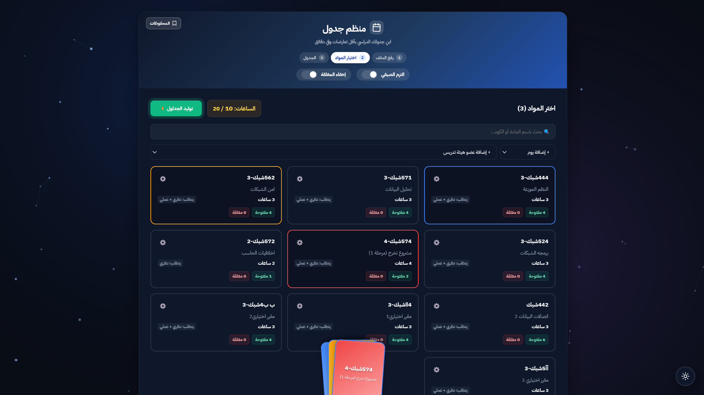 | 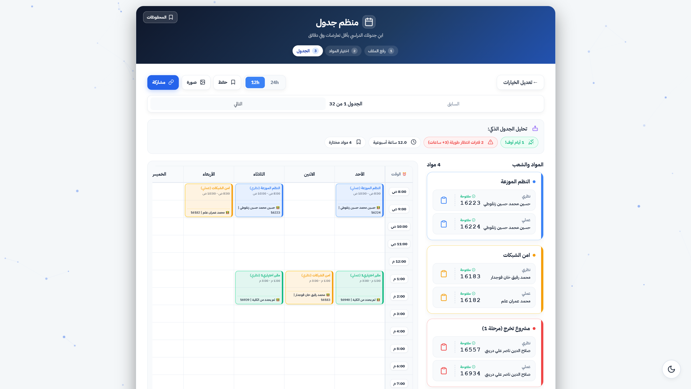 |
| 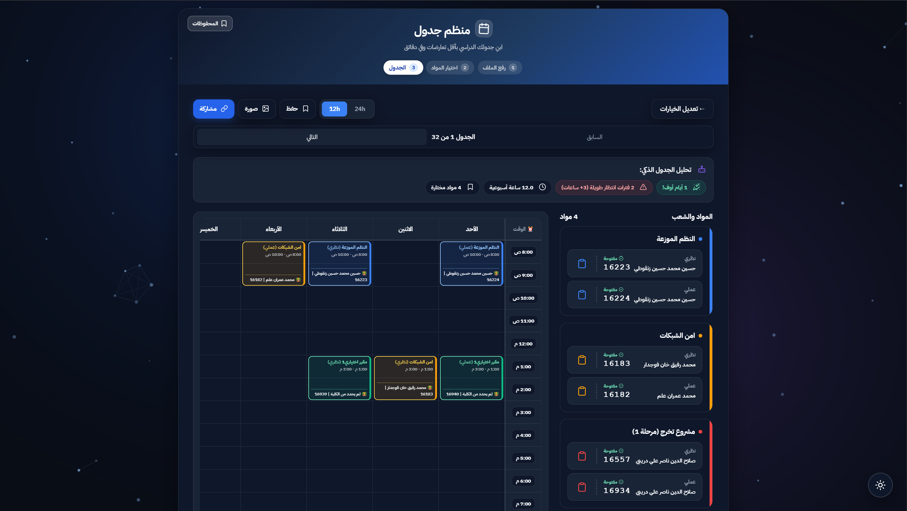 | 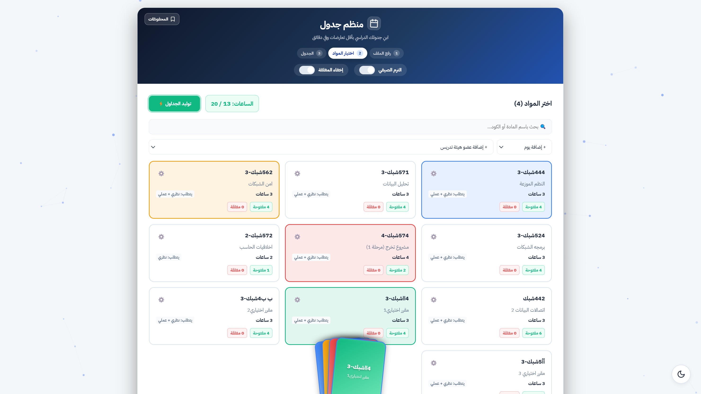 |
| 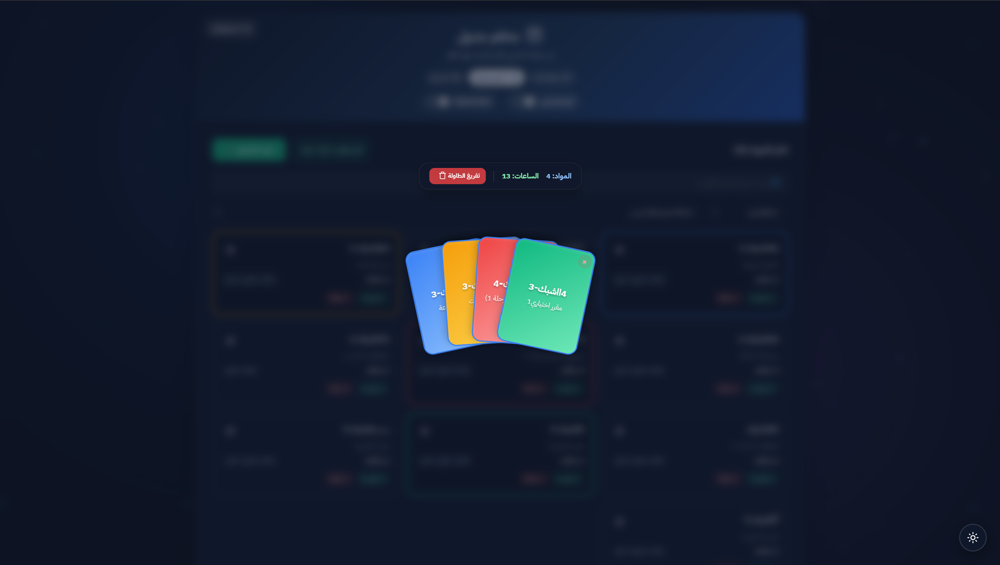 | 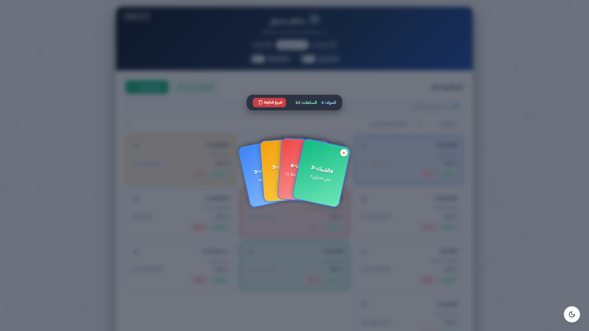 |

### Mobile
| Dark Mode | Light Mode |
|:---:|:---:|
| 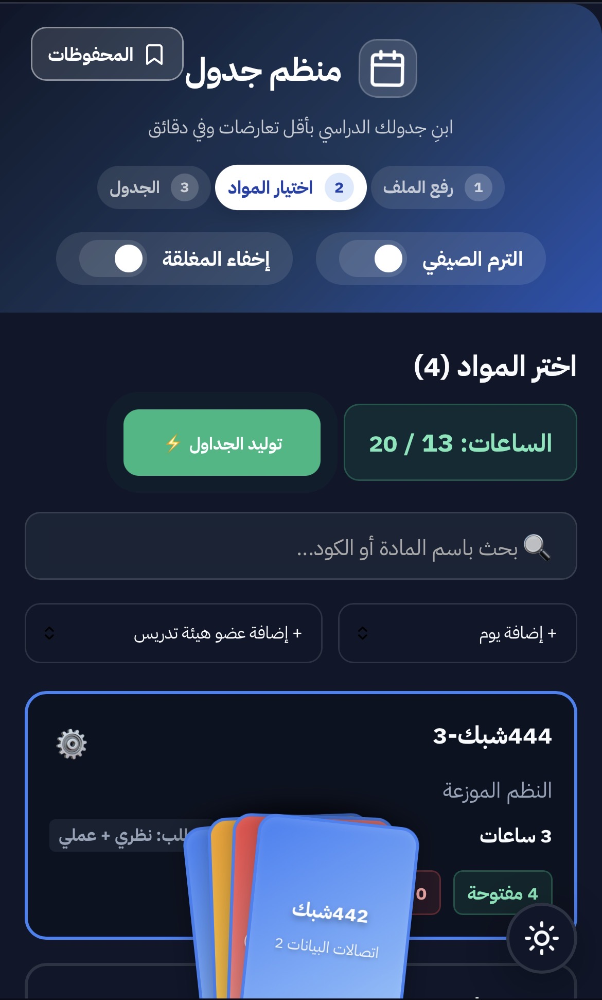 | 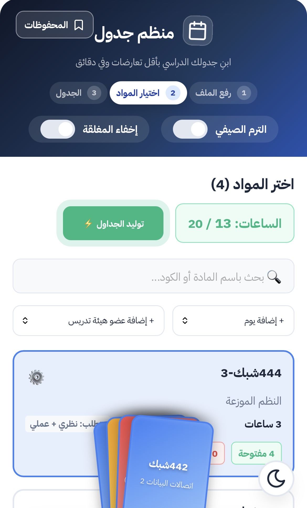 |
| 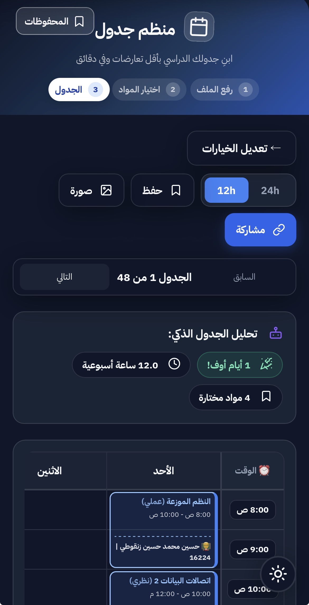 | 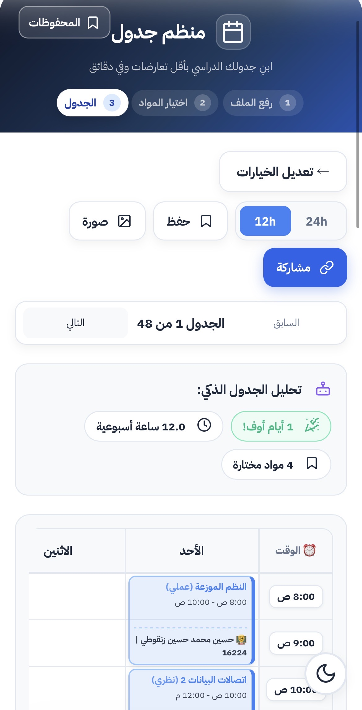 |
| 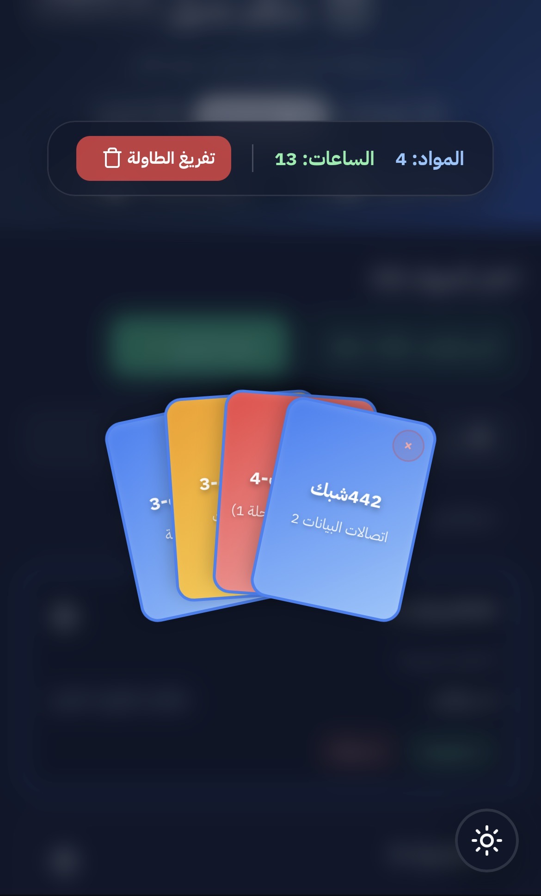 | 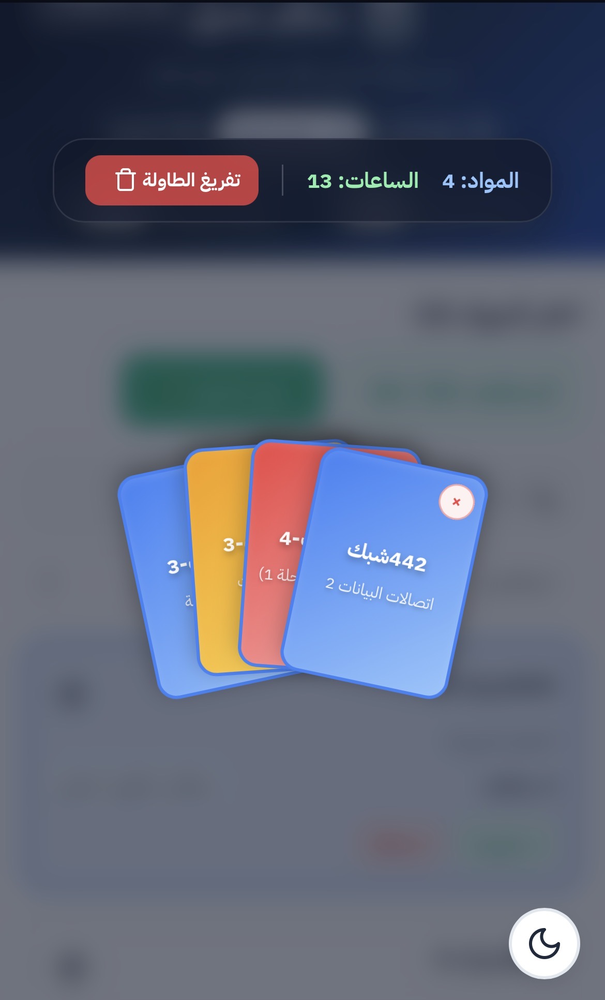 |

---

## Disclaimer
> This tool is an **independent student initiative** and is not affiliated with, endorsed by, or connected to Jazan University or any official entity. It is designed solely as a planning utility and is NOT a substitute for official course registration. Selecting a schedule via this tool does not guarantee a seat in any section. **You must always complete your official add/drop process through the university's academic portal.**

---

## Contact & Support
If you have suggestions for improvement, encounter a bug, or wish to connect, please feel free to reach out via email:
Email: [abdulazizmashnawi@gmail.com](mailto:abdulazizmashnawi@gmail.com)

 

  
Built with passion for the students of Jazan University.

